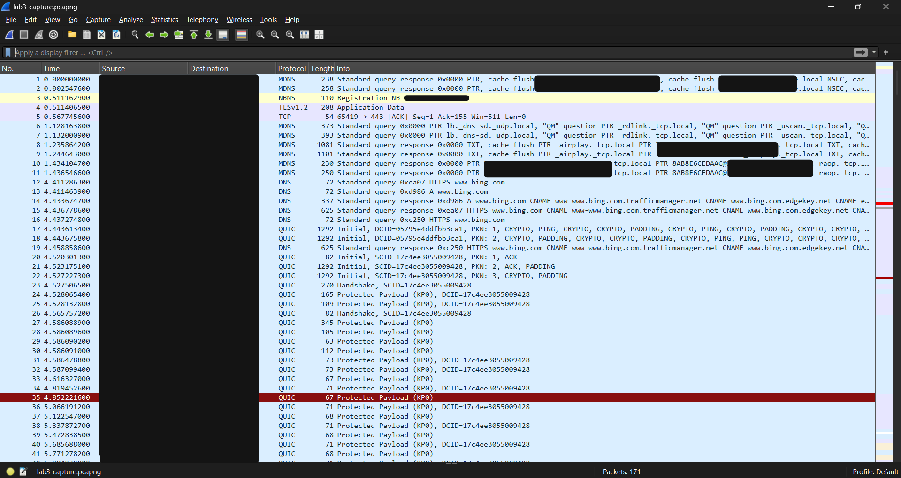
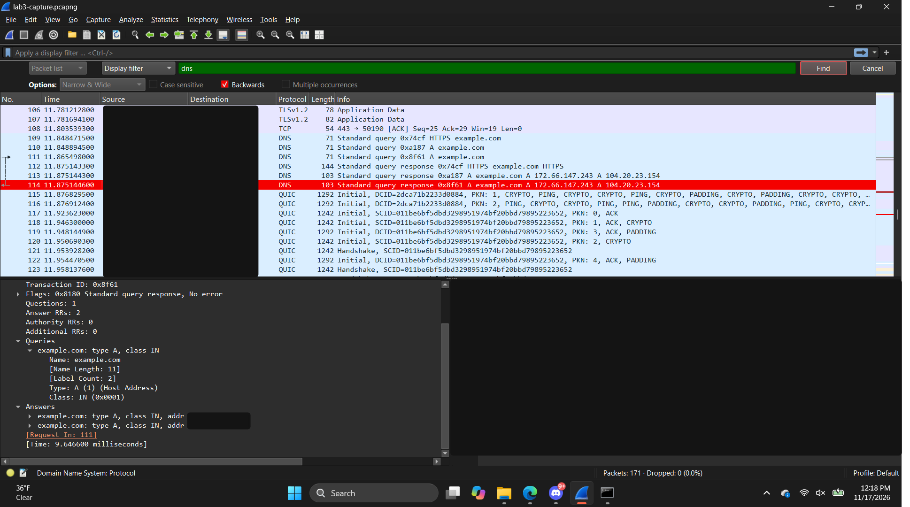
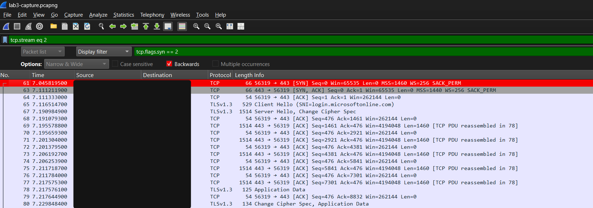
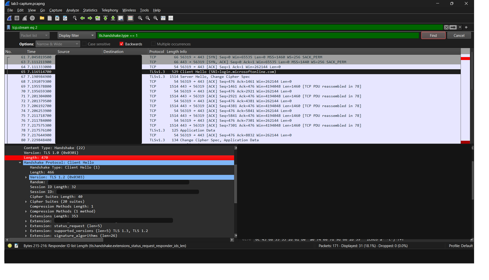

# Lab 3 - Wireshark Network Traffic Analysis

## 1. Traffic Capture Overview

Network traffic was captured using Wireshark on a Windows computer to examine common network protocols and communication between devices and external services.

### Observations
- A total of 171 packets were captured.
- Multiple protocols were identified, including DNS, TCP, TLS, QUIC, mDNS, and NBNS.
- Both local network discovery and encrypted web traffic were observed.

### Evidence

## 2. DNS Analysis

DNS traffic was examined to understand how domain names are resolved into IP addresses.

### Observations
- Queried domain: example.com
- Record type: A (IPv4 address)
- Response status: No error
- Two A records were returned.
- DNS response time: approximately 9.65 milliseconds.

### Security Significance
DNS analysis can assist with identifying suspicious domain requests, investigating potential malicious communications, and troubleshooting name resolution issues.

### Evidence

## 3. TCP Three-Way Handshake

Display filter: `tcp.stream eq 2`

A TCP connection was examined to identify the three-way handshake used to establish communication between a client and server.

### Observations
- Packet 61: SYN
- Packet 63: SYN/ACK
- Packet 64: ACK
- Client source port: 56319
- Server destination port: 443
- TLS communication followed the successful TCP handshake.

### Security Significance
Understanding TCP connection establishment is useful for troubleshooting connectivity issues and investigating abnormal connection behavior.

### Evidence

## 4. TLS Analysis

Search expression: `tls.handshake.type == 1`

A TLS Client Hello message was examined to understand how encrypted communication is negotiated.

### Observations
- Packet 65 contained a Client Hello message.
- The client offered 20 cipher suites.
- Supported TLS versions included TLS 1.3 and TLS 1.2.
- TLS extensions included server name, status request, supported versions, and signature algorithms.
- Subsequent encrypted application traffic was observed.

### Security Significance
TLS analysis allows security professionals to examine encryption negotiation and connection metadata without decrypting application data.

### Evidence

## 5. Conclusion

This lab provided hands-on experience capturing, filtering, and analyzing network traffic using Wireshark.

The investigation demonstrated foundational skills in:

- Network protocol analysis
- DNS investigation
- TCP connection analysis
- TLS handshake analysis
- Network troubleshooting
- Technical documentation
- Handling sensitive network information

## 6. Privacy Considerations

Sensitive network addresses and device identifiers were redacted from the published screenshots. The original packet capture remains private to prevent unintended disclosure of network information.
