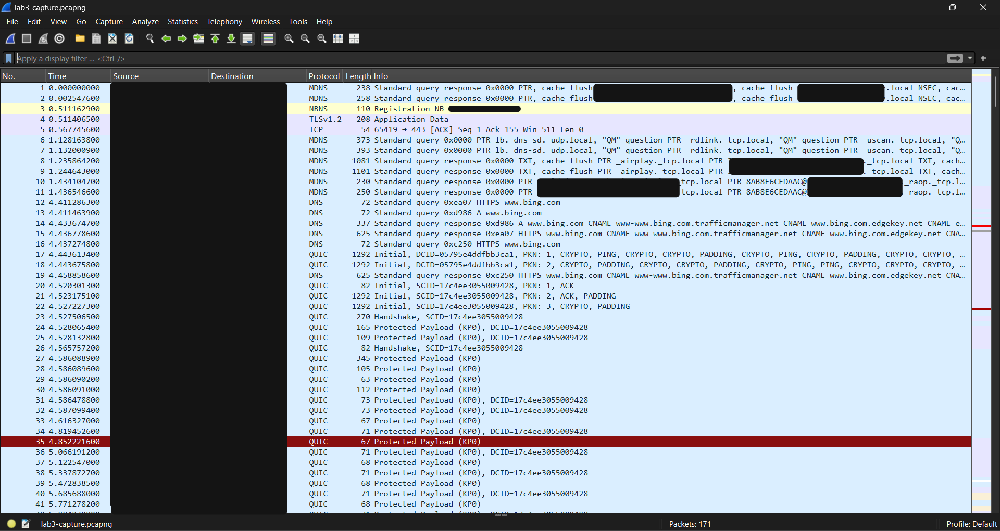
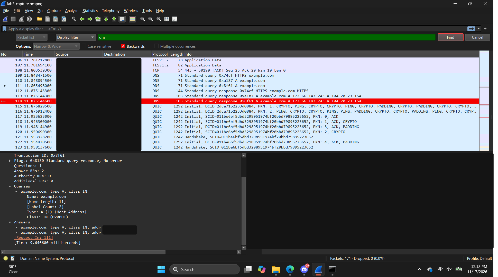
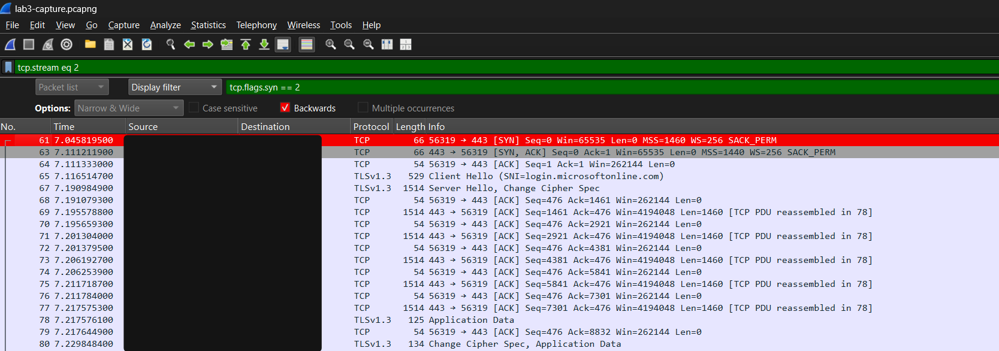
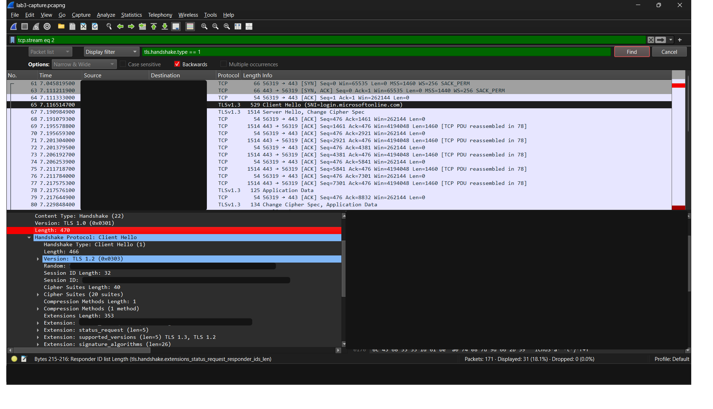

# Wireshark Network Traffic Analysis

## Project Overview

This project demonstrates hands-on network traffic analysis using Wireshark to investigate common network protocols, connection establishment, and encrypted communications in a Windows environment.

The purpose of this lab was to develop practical networking, cybersecurity, and troubleshooting skills through the analysis of real network traffic.

## Objectives

- Capture and examine network traffic.
- Identify common network protocols.
- Investigate DNS queries and responses.
- Analyze the TCP three-way handshake.
- Examine TLS handshake information.
- Document technical findings while protecting sensitive information.

## Tools and Technologies

- Wireshark
- Microsoft Windows
- Windows Command Prompt
- DNS
- TCP/IP
- HTTPS/TLS
- GitHub

## Methodology

1. Captured network traffic using Wireshark.
2. Generated DNS traffic using the nslookup command.
3. Examined DNS queries and responses.
4. Isolated a TCP stream to investigate connection establishment.
5. Examined a TLS Client Hello message and its encryption-related metadata.
6. Documented observations and redacted sensitive network information.

## Lab Demonstrations

### 1. Network Traffic Capture

Captured 171 packets containing multiple protocols, including DNS, TCP, TLS, QUIC, mDNS, and NBNS.

### 2. DNS Analysis

Examined a successful DNS query and response for example.com, identifying IPv4 address records and response time.

### 3. TCP Three-Way Handshake

Identified the SYN, SYN/ACK, and ACK packets used to establish a TCP connection to destination port 443.

### 4. TLS Analysis

Examined a TLS Client Hello message, identifying 20 offered cipher suites, supported TLS versions, and handshake extensions.

## Detailed Findings

The complete technical investigation, observations, and security implications are documented in the following report:

[View Detailed Findings](findings.md)

## Skills Demonstrated

- Network traffic analysis
- Packet capture and inspection
- Wireshark filtering and searching
- Network protocol identification
- DNS and TCP/IP fundamentals
- Network troubleshooting
- TLS handshake analysis
- Technical documentation
- Sensitive information handling

## Privacy and Security

Published screenshots have been redacted to protect sensitive network information and device identifiers. The original packet capture is not included in this repository.

## Conclusion

This project strengthened my understanding of network communication, protocol behavior, and encrypted connections through practical experience with Wireshark.

The skills developed in this lab are applicable to IT support, network troubleshooting, cybersecurity investigations, and security operations.
